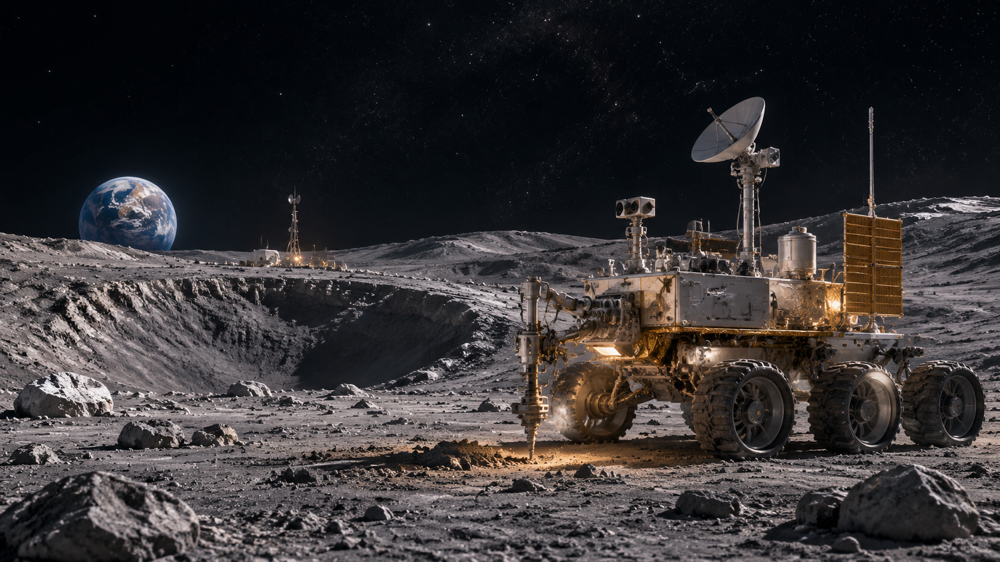

美国航空航天局（NASA）近日宣布，8家公司将参与新一轮“月球商业运载服务计划”任务竞标。同时，NASA还在推进一辆核动力月球车的研制，计划前往月球南极探测水冰和其他资源。商业货运、极区探测以及通信和能源设施的规划，指向同一个目标：为未来更长期的月球表面活动做准备。

## 月球货运交给商业公司竞标

NASA在佛罗里达州肯尼迪航天中心举行的航空航天展会上，发布了为期10年的新一轮月球商业运载服务合同框架。蓝色起源等8家公司将参与月球表面货物运输任务的竞标，运送对象包括科学载荷、技术设备和基础设施。

这类服务的重点，是让科研设备和建设所需物资能够按任务需求抵达月面。随着月球任务增加，运输能力不仅关系到单次探测能携带什么，也会影响后续设备部署和地面活动如何展开。新一轮合同框架为NASA提供了由多家商业公司竞标承运任务的安排。

## 核动力月球车计划探测南极

NASA计划在2028年年底发射名为“承诺”（正式名称为“核动力极区观测、测绘与原位探测漫游车”）的月球车。任务周期预计为18个月，目标是在月球南极着陆，对月表及地下环境开展探测，评估资源潜力，并为未来着陆点选择、基础设施建设和探测任务提供数据。

这辆六轮月球车将配备钻探设备，采集月壤样本，分析月表以下约一米范围内的水冰及其他资源。车上还计划搭载光谱仪，用于分析月面物质的化学成分，并配备温度、辐射传感器和可见光相机。

极区环境对探测设备的工作能力提出了要求。NASA表示，核动力月球车能够在月夜及永久阴影区域运行。相比只在有日照时工作的探测设备，这种能力有望让任务覆盖更长时间和更多类型的环境，为未来人类长期驻留提供探测数据。

NASA已授予蓝色起源公司相关合同，由该公司使用“马克一号”星际飞船运送并部署“承诺”号。也就是说，月球车的科学任务与商业运输服务将直接衔接：先把探测器送到月面，再由它在目标区域展开工作。

## 通信和供电也纳入建设计划

除了货运和探测器，NASA还宣布采购太阳能电池阵列、蓄电池和无线电力传输硬件等组件，用于月球基地的通信与能源设施。相关设备将组成一套小型通信与太阳能塔系统，为未来月球表面活动提供电力和通信支持。

这项安排说明，月球探测的规划不只关注“如何抵达”，还包括设备着陆后如何获得能源、维持通信并持续工作。运输服务负责把设施送到月面，探测任务帮助了解环境和资源，而供电与通信系统则为后续活动提供基础条件。

## 从单次探测走向长期准备

目前公布的仍是合同框架、采购安排和任务计划，相关项目还需要经过研制、运输和部署等环节。按照NASA公布的信息，“承诺”号的目标发射时间是2028年年底，任务周期为18个月；实际进度和探测结果仍有待后续任务验证。

但从计划的组合来看，NASA正在同时推进月面货物运输、极区资源探测以及通信和能源设施建设。它们分别解决物资抵达、环境认知和设备运行的问题。只有这些环节能够配合起来，未来的月球基地建设和长期驻留才有更扎实的数据与基础设施支撑。
