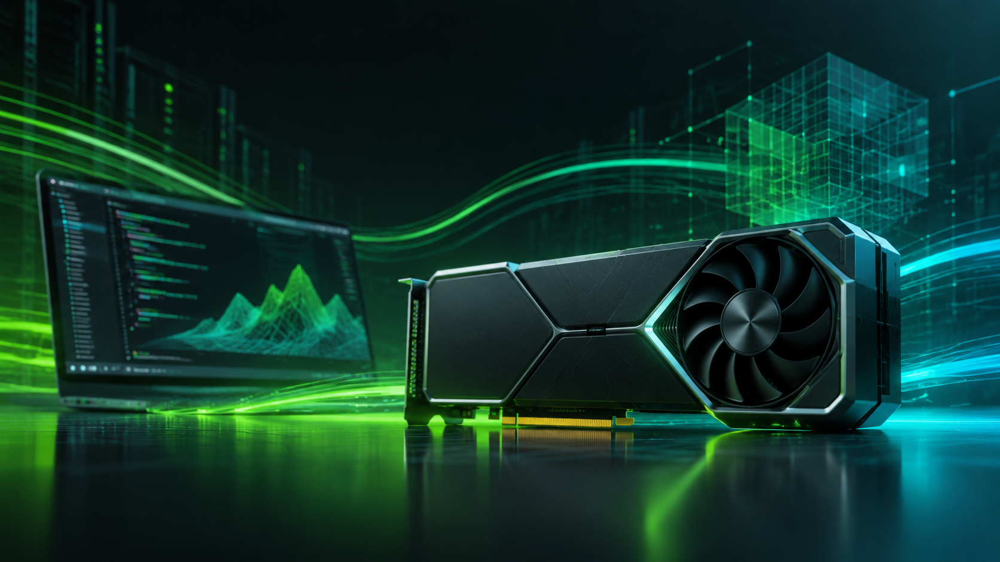

第一次接触CUDA时，最容易卡在“明明装了显卡驱动，为什么还不能编译CUDA程序？”这个问题上。GPU驱动、CUDA Toolkit、环境变量和编译器是几件不同的事，安装顺序也有讲究。

这篇作为CUDA学习笔记第一期，先把环境搭建这条链路跑通：装好驱动，安装Toolkit，验证`nvidia-smi`和`nvcc`，再编译一个最小的GPU程序。



## 先分清驱动和Toolkit

可以把GPU驱动理解成“让操作系统使用显卡的基础软件”，而CUDA Toolkit是“在这个基础上开发GPU程序的工具箱”。

驱动负责让系统识别GPU、管理显存和执行任务；Toolkit则提供`nvcc`编译器、CUDA Runtime、数学库、性能分析工具和调试器。只安装驱动，可以运行已经编译好的CUDA程序，但不能直接用`nvcc`编译`.cu`文件；只安装Toolkit，也不能代替驱动访问真实的GPU。

版本关系可以记住一句话：**驱动通常向前兼容旧版Toolkit编译的程序，但Toolkit不能反过来替代驱动。**每个Toolkit版本都有最低驱动要求，驱动版本达到要求即可，不需要和Toolkit的小版本号完全相同。

还要注意，`nvidia-smi`中的`CUDA Version`表示当前驱动最高支持的CUDA版本，不代表机器上已经安装了这个版本的Toolkit。真正查看`nvcc`版本，应使用`nvcc --version`。

| 命令 | 主要回答的问题 |
| --- | --- |
| `nvidia-smi` | 驱动是否正常，系统是否识别GPU |
| `nvcc --version` | Toolkit和CUDA编译器是否可用 |
| `which nvcc`或`where nvcc` | 当前调用的是哪一份编译器 |

## 安装驱动并完成第一次验证

### Linux：优先使用发行版包管理器

Ubuntu上建议先查看系统推荐的驱动版本，再通过`apt`安装。下面的版本号只是示例，实际以发行版推荐结果为准：

```bash
sudo apt update
ubuntu-drivers devices
sudo apt install nvidia-driver-XXX
sudo reboot
```

重启后执行：

```bash
nvidia-smi
```

如果能看到GPU名称、Driver Version和显存使用情况，说明驱动已经被系统加载。生产服务器尽量使用包管理器安装，后续升级和卸载更容易维护。官方`.run`安装包适合有明确需求的场景，使用前通常需要处理nouveau，并切换到文本终端，排错成本更高。

### Windows：安装官方驱动

Windows用户从NVIDIA驱动下载页面选择GPU型号和系统版本，安装时可以选择“自定义安装”。完成后在PowerShell或命令提示符中运行：

```powershell
nvidia-smi
```

如果这里提示找不到命令，先确认驱动是否安装成功，再检查系统环境变量和终端是否已经重新打开。

## 安装CUDA Toolkit并配置环境变量

驱动确认正常后，再安装Toolkit。Linux上可以使用官方仓库或runfile。使用runfile时，如果驱动已经单独安装完成，应取消安装界面中的Driver选项，避免覆盖现有驱动。只想为当前开发环境安装工具链时，也可以使用：

```bash
sudo apt install cuda-toolkit-12-6
```

版本号请替换成实际需要的版本。Windows上建议从CUDA Toolkit Archive下载对应安装包，选择Custom模式，只勾选需要的组件。Python开发者还可以在已有系统驱动的前提下，把Toolkit或运行时放进独立的conda环境：

```bash
conda install -c nvidia cuda-toolkit=12.6
```

这种方式方便项目之间隔离版本，但它仍然不能替代系统级GPU驱动。

### Linux环境变量

假设Toolkit安装在`/usr/local/cuda-12.6`，在`~/.bashrc`或`~/.zshrc`中加入：

```bash
export CUDA_HOME=/usr/local/cuda-12.6
export PATH=$CUDA_HOME/bin:$PATH
export LD_LIBRARY_PATH=$CUDA_HOME/lib64:$LD_LIBRARY_PATH
```

保存后执行：

```bash
source ~/.bashrc
nvcc --version
which nvcc
```

### Windows环境变量

在系统环境变量中确认或新增：

```text
CUDA_PATH=C:\Program Files\NVIDIA GPU Computing Toolkit\CUDA\v12.6
```

再把`%CUDA_PATH%\bin`加入`Path`。重新打开终端后运行：

```powershell
nvcc --version
where nvcc
```

这里最好同时记录`nvidia-smi`和`nvcc --version`的输出。前者看驱动，后者看Toolkit，排错时不会把两个版本混为一谈。

## 用一个Hello World打通工具链

环境是否真的可用，不能只看版本号，最好编译一个最小程序。新建`hello_cuda.cu`：

```cpp
#include <cstdio>
#include <cuda_runtime.h>

__global__ void helloKernel() {
    printf("Hello from GPU thread %d in block %d!\n",
           threadIdx.x, blockIdx.x);
}

int main() {
    printf("Launching kernel...\n");

    helloKernel<<<2, 4>>>();
    cudaError_t err = cudaDeviceSynchronize();

    if (err != cudaSuccess) {
        std::fprintf(stderr, "CUDA error: %s\n",
                     cudaGetErrorString(err));
        return 1;
    }

    printf("Done!\n");
    return 0;
}
```

编译并运行：

```bash
nvcc hello_cuda.cu -o hello_cuda
./hello_cuda
```

Windows下运行生成的`hello_cuda.exe`即可。输出中应该能看到多个线程打印问候语。线程和Block的执行顺序由GPU调度器决定，因此输出顺序可能变化，这不是程序出错。

如果需要指定目标架构，可以使用：

```bash
nvcc -arch=sm_89 hello_cuda.cu -o hello_cuda
```

`sm_89`只是RTX 40系列等GPU的示例，实际项目应根据目标GPU的计算能力选择。需要兼容多种GPU时，使用多个`-gencode`生成对应的fatbinary，或者交给CMake统一配置。

## 用CMake管理实际项目

手动调用`nvcc`适合验证环境，项目变大后建议使用CMake。一个最小的`CMakeLists.txt`如下：

```cmake
cmake_minimum_required(VERSION 3.18)
project(cuda_demo LANGUAGES CXX CUDA)

set(CMAKE_CXX_STANDARD 17)
set(CMAKE_CUDA_STANDARD 17)
set(CMAKE_CUDA_ARCHITECTURES 89)

add_executable(hello hello_cuda.cu)
```

构建：

```bash
cmake -S . -B build -DCMAKE_BUILD_TYPE=Release
cmake --build build -j
```

把GPU架构写在`CMAKE_CUDA_ARCHITECTURES`里，比把`-arch`散落在脚本中更容易维护。更换显卡或部署目标时，只需要调整一处配置。

## 常见问题与排查顺序

遇到报错时，建议按“驱动→Toolkit→环境变量→编译参数→程序运行”的顺序排查：

| 现象 | 常见原因 |
| --- | --- |
| `nvidia-smi: command not found` | 驱动未安装，或命令路径没有加入PATH |
| `driver/library version mismatch` | 驱动更新后没有重启，先执行`sudo reboot` |
| `nvcc: command not found` | Toolkit未安装，或`CUDA_HOME`和`PATH`未配置 |
| `unsupported gpu architecture` | 当前Toolkit太旧，不认识目标GPU架构 |
| `cannot find -lcudart` | Linux下的`LD_LIBRARY_PATH`没有包含CUDA库目录 |
| `no CUDA-capable device` | 驱动、GPU识别或容器透传存在问题 |

还可以下载NVIDIA官方`cuda-samples`，编译`deviceQuery`进行完整检查：

```bash
git clone https://github.com/NVIDIA/cuda-samples.git
cd cuda-samples/Samples/1_Utilities/deviceQuery
make
./deviceQuery
```

如果最后出现`Result = PASS`，说明驱动、Toolkit和GPU之间的基本链路已经打通。CUDA 11.6之后，Samples通常需要从GitHub单独下载，不一定随Toolkit安装包提供。

---

## 写在最后

CUDA环境搭建的关键不是把所有组件一次性装满，而是确认每一层都能独立工作：先让`nvidia-smi`识别GPU，再让`nvcc`找到Toolkit，最后用一个小程序验证编译和运行。

后续学习Kernel、显存、线程层级和性能优化时，环境问题就不应该再成为主要障碍。记住这条顺序：**装驱动，装Toolkit，配环境变量，编译程序，最后用deviceQuery复核。**
