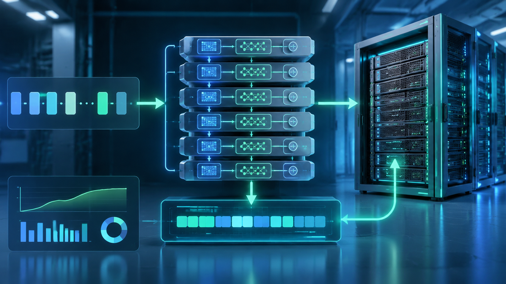

谈到 Decoder-only 模型成为主流，最容易想到的是模型效果：它适合自回归生成，经过大规模预训练后能自然地完成续写、问答、代码生成和工具调用。

但“效果好”并不能完全解释它为什么能迅速成为工程上的默认选择。一个同样重要的原因是：**Decoder-only 把训练、推理、并行和性能优化尽可能地统一成了一条路径。**

对一个需要长期训练、部署和迭代的大模型系统来说，统一往往比局部最优更有价值。下面从几个工程角度来看，Decoder-only 为什么更容易做大、做快、做稳定。



## 一、先看两种架构在做什么

经典 Transformer 通常有两种组织方式：

- **Encoder-only**：输入经过双向注意力，适合表示和理解，例如分类、检索和序列标注。
- **Encoder-Decoder**：Encoder 处理输入，Decoder 根据 Encoder 输出自回归生成，适合翻译、摘要等输入输出边界清晰的任务。
- **Decoder-only**：所有内容放进同一个自回归序列中，模型只根据当前位置之前的 Token 预测下一个 Token。

Encoder-Decoder 并不是性能差，而是它把一个请求拆成了两套有差异的计算过程：Encoder 处理源序列，Decoder 处理目标序列；Decoder 内部还同时包含因果自注意力和 Cross-Attention。

Decoder-only 则把问题统一成了：

```text
给定前面的 Token，预测下一个 Token
```

这个定义简单，却给底层系统带来了很强的复用能力。

## 二、架构统一性：一套 Block 反复堆叠

一个典型的 Decoder-only 模型可以抽象成：

```text
Embedding
    -> Decoder Block
    -> Decoder Block
    -> ...
    -> Decoder Block
    -> LM Head
```

每一层 Decoder Block 通常都由相同类型的组件组成：归一化、因果 Attention、残差连接和 FFN。层与层之间主要是参数不同，计算结构基本一致。

这种重复结构看起来只是模型设计上的整齐，实际上直接决定了工程实现的复杂度。

### 1. 序列维度更统一

Decoder-only 主要围绕一个序列长度展开。无论是 Prefill 还是 Decode，系统都在处理同一个自回归序列，只是一次处理的 Token 数量不同：

- **Prefill**：一次处理用户输入中的大量 Token，建立隐藏状态和 KV Cache。
- **Decode**：每轮通常只追加一个或少量 Token，读取已有 KV Cache 并继续生成。

Encoder-Decoder 至少需要同时考虑源序列长度和目标序列长度。两者的注意力模式、生命周期和调度方式都不同，批处理、Padding、内存布局和性能模型也会更复杂。

需要注意的是，Decoder-only 并不是“只有一种张量形状”。不同请求仍然会有不同长度，Prefill 和 Decode 也有不同的执行形态。它的优势在于：**核心语义都围绕同一种自回归序列组织，系统不需要额外维护一套 Encoder 到 Decoder 的结构边界。**

### 2. CUDA Kernel 可以大规模复用

如果模型有 $L$ 层相似的 Decoder Block，那么 Attention、FFN、RMSNorm 和残差相关的 kernel 可以被反复使用：

```text
同一套 Attention kernel  -> 运行 L 次
同一套 FFN kernel        -> 运行 L 次
同一套通信模式           -> 运行 L 次
```

这会带来几个实际好处：

1. 算子优化只需要集中在一套主路径上。
2. 算子融合、量化和低精度适配更容易覆盖全模型。
3. Kernel 的输入输出模式稳定，编译缓存和自动调优结果更容易复用。
4. 出现性能回退时，修复一个 Block 的实现通常能影响所有层。

Encoder-Decoder 则要分别处理 Encoder Block、Decoder Self-Attention、Decoder Cross-Attention，以及它们之间不同的张量形状和访存模式。组件数量不一定多很多，但分支更多，优化结果也更难完全复用。

### 3. 并行策略只需要设计一次

大模型训练和推理通常要组合使用数据并行、张量并行、流水线并行和序列并行。Decoder-only 的每一层结构相似，因此可以比较自然地沿层切分或沿隐藏维度切分：

- Tensor Parallel 负责切分 Attention 和 FFN 的矩阵计算；
- Pipeline Parallel 负责把连续的 Decoder Block 分配到不同设备；
- Data Parallel 负责复制模型并处理不同数据分片；
- Sequence Parallel 负责降低序列相关中间结果的显存压力。

Encoder-Decoder 也可以使用这些并行方式，但需要额外决定 Encoder 和 Decoder 如何分配设备，以及 Cross-Attention 的通信边界放在哪里。不同阶段的序列长度和计算量还可能不平衡，流水线调度因此更难调优。

### 4. 性能分析和故障定位更直接

Decoder-only 中，任意一层的执行时间、显存占用和通信行为，通常都能代表其他层。工程上可以更容易回答这些问题：

- 是 Attention 计算慢，还是 FFN 计算慢？
- 是计算单元没有吃饱，还是显存带宽成为瓶颈？
- 是某个 kernel 性能退化，还是设备间通信占比过高？
- 是所有层都慢，还是某个特殊模块出现异常？

如果一个 Block 的 Profile 结果稳定，就可以通过层数估算整体开销。相反，Encoder-Decoder 需要分别分析两个阶段和 Cross-Attention，瓶颈可能只出现在某一侧。

## 三、KV Cache：只需要维护一条主要缓存路径

自回归生成时，模型不会每生成一个 Token 就重新计算完整历史。它会把历史 Token 在各层产生的 Key 和 Value 保存下来，后续 Decode 直接读取，这就是 KV Cache。

Decoder-only 的 KV Cache 主要围绕一件事展开：**保存当前序列在每个 Decoder 层的 Key 和 Value。**

这使得 PagedAttention、Prefix Caching、KV Cache 量化和显存分页等优化可以直接围绕一套缓存模型设计：

```text
请求到达
  -> 分配 KV Cache block
  -> Prefill 写入缓存
  -> Decode 逐步追加缓存
  -> 请求结束后回收 block
```

Encoder-Decoder 通常需要同时考虑：

1. Encoder 输出或其投影结果的缓存；
2. Decoder 自注意力产生的 KV Cache；
3. Cross-Attention 对 Encoder 输出的读取；
4. 源序列和目标序列不同的生命周期。

这并不意味着 Encoder-Decoder 无法使用分页缓存，而是缓存管理器需要知道两套缓存的来源、形状、共享方式和释放时机。对于多租户、高并发服务来说，状态种类越少，内存碎片、调度分支和边界 Bug 就越少。

## 四、Scaling 路径清晰：三个主要旋钮

当模型需要扩大规模时，Decoder-only 提供了相对直观的扩展方向：

1. 增加层数 $L$；
2. 增加隐藏维度或 FFN 宽度；
3. 增加 Attention Head 数量。

在其他条件大致不变时，模型参数量和计算量可以用近似关系理解：

$$
\text{Compute} \approx O\left(L \cdot (T \cdot d^2 + T^2 \cdot d)\right)
$$

其中 $L$ 是层数，$T$ 是序列长度，$d$ 是隐藏维度。这个公式不等于真实硬件上的最终性能，但足以帮助工程团队估算扩容代价：增加层数会近似线性增加层级计算；增加宽度会同时放大矩阵计算和显存需求；增加上下文长度会提高 Attention 的序列相关成本和 KV Cache 占用。

对于 Encoder-Decoder，除了总层数和宽度，还要决定 Encoder 与 Decoder 的比例。例如，总参数量固定时，应该把更多层放在 Encoder 还是 Decoder？源序列和目标序列长度变化后，最佳比例是否仍然成立？这些选择会影响计算平衡、流水线切分和推理延迟。

Decoder-only 也不是只有这三个旋钮。现代模型还会引入 GQA、MoE、稀疏 Attention、滑动窗口和不同位置编码。但这些扩展通常是在统一的 Decoder 主体上增加能力，而不是再引入一套完全不同的编码阶段。

## 五、训练数据利用率高：每个位置都有直接的预测目标

Decoder-only 通常使用因果语言建模目标：给定前面的 Token，预测下一个 Token。对于长度为 $T$ 的序列，模型可以在一次前向中并行计算所有位置的预测，只是第 $i$ 个位置只能看到前 $i$ 个 Token。

```text
输入：  我  喜欢  学习  大模型
目标：  喜欢  学习  大模型  工程
```

除了序列开头没有前文的特殊位置之外，序列中的每个 Token 都能作为一个预测目标产生 loss。也就是说，一段普通文本的绝大多数位置都直接贡献训练信号，数据利用率高，训练目标也与下游生成行为一致。

这里需要把表述说准确：Encoder-Decoder 并不是只有 Decoder 的 Token 才参与任何计算，Encoder 的表示会通过 Cross-Attention 影响 Decoder 的 loss，并接收梯度回传。更准确的区别是：**Encoder 侧的源 Token 通常没有对应的直接预测目标，训练信号主要由目标序列的 Token 提供。**

这会带来两个工程结果：

- 相同长度的纯文本，Decoder-only 可以让更多位置直接参与语言建模；
- 训练目标、推理目标和数据配比之间的关系更简单，数据管线不必额外维护 source-target 对齐。

当然，“接近 100%”不是无条件成立的。实际训练还会受到文档边界、Padding、特殊 Token、loss mask、packing 策略和数据清洗规则影响。这里的核心优势是训练信号覆盖范围广，而不是每个物理输入位置永远都计算有效 loss。

## 六、工程收益会在规模变大后放大

单机实验时，Encoder-Decoder 多出的结构边界可能并不明显。模型规模、并发和团队人数上升后，统一性会持续产生复利：

| 工程环节 | Decoder-only 的直接收益 |
| --- | --- |
| 算子开发 | Attention、FFN、Norm 等主路径重复复用 |
| 分布式训练 | 层结构一致，切分和通信模式更容易模板化 |
| 推理服务 | Prefill、Decode、KV Cache 围绕一条序列组织 |
| 显存管理 | 主要维护一类按层、按请求增长的 KV Cache |
| 性能调优 | 单层 Profile 结果更容易外推到全模型 |
| 模型扩展 | 加层、加宽、加头的扩展路径更直观 |
| 团队协作 | 算子、编译、调度和模型代码的边界更稳定 |

这些优势不会让某个单独 kernel 自动变快，却会降低整个系统的复杂度。复杂度下降后，工程团队可以更快完成量化、并行化、硬件适配和版本迭代，也更容易把优化成果迁移到不同尺寸的模型上。

## 七、Decoder-only 不是所有任务的最优解

工程友好不等于任务表现永远最好。Encoder-Decoder 在一些场景依然有明确价值：

- 输入和输出是两个边界清晰的序列，例如翻译和结构化转换；
- 输入很长、输出相对较短，希望避免让生成阶段重复承载全部输入上下文；
- 需要对输入做双向建模，再根据完整输入生成目标序列。

Decoder-only 的代价也很实际：在生成每个 Token 时，历史输入会保留在上下文和 KV Cache 中；长上下文会增加 Prefill 时间和显存占用。把输入输出拼成一个序列虽然统一，却不代表它在所有长输入任务上都更省资源。

因此，更准确的结论不是“Decoder-only 在架构上绝对更先进”，而是：**在通用大模型需要持续预训练、规模化扩展、多硬件部署和高并发服务的条件下，Decoder-only 用统一性换来了更低的系统复杂度。**

## 八、结论

Decoder-only 成为大模型主流，模型效果只是其中一部分原因。它真正强大的地方，在于把很多原本需要分别设计的工程问题，压缩成了同一条可以重复利用的路径：

1. 只有一种主要 Block，kernel 和优化经验可以跨层复用；
2. 围绕一条自回归序列组织计算，调度和张量维度更统一；
3. KV Cache 主要维护一套数据结构，分页和缓存复用更容易落地；
4. Scaling 主要围绕层数、宽度和头数展开，扩容路径更容易预测；
5. 语言建模 loss 覆盖大量 Token，训练目标和生成目标保持一致。

大模型系统的竞争，最终不只是某个模型在基准集上高出几个百分点，还包括训练是否容易扩展、推理是否容易优化、故障是否容易定位，以及新硬件是否能快速适配。Decoder-only 恰好在这些工程问题上提供了一种足够统一的默认答案，这就是它对工程最友好的根本原因。
